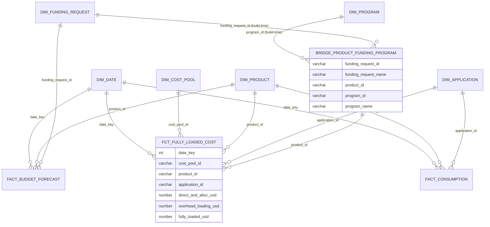

# Part A.1 - Target Analytical Data Model

Companion image: `A_Data_Model.svg`.

## Shape

A star (constellation) schema: one core cost fact, two satellite facts, and conformed dimensions. The source `fact_allocation_map` is treated as a rules/config table (staging), not a fact, because it holds no measured event.

## Core fact: FCT_FULLY_LOADED_COST

- **Grain:** one row per `date_key x cost_pool_id x product_id x application_id` (monthly).
- **Design choice:** cost pool is kept in the grain (not collapsed) so scenario analysis can act on individual pools.
- **Measures:** `direct_and_alloc_usd`, `overhead_loading_usd`, `fully_loaded_usd` (= direct + allocated + overhead). Overhead is a separate additive column so the shared-overhead policy is transparent.

## Satellite facts

- **FACT_BUDGET_FORECAST** - grain `date_key x product_id`: budget_usd and forecast_usd, sourced as delivered.
- **FACT_CONSUMPTION** - retained as delivered (`date x product x application x region x entity x driver`): source of allocation weights and the denominator for unit-cost measures.

`VW_VARIANCE` is a downstream reporting view, not a base satellite fact — it compares actual (aggregated from `FCT_FULLY_LOADED_COST`) against `FACT_BUDGET_FORECAST` at grain `date_key x product_id`.

## Conformed dimensions

`DIM_DATE`, `DIM_COST_POOL`, `DIM_PRODUCT`, `DIM_APPLICATION`, and (for rollup) `BRIDGE_PRODUCT_FUNDING_PROGRAM`. `DIM_REGION` and `DIM_LEGAL_ENTITY` are optional context, reachable via the consumption fact, not the cost fact.

## Keys

Source business keys (`CP01`, `PR01`, `APP001`) are clean, stable, and unique, so they are used as-is. Funding request and program are not native to any cost table, so the model materializes a `BRIDGE_PRODUCT_FUNDING_PROGRAM` bridge table that rolls the cost fact up to funding request and program: it takes `FUNDING_REQUEST_ID`, `FUNDING_REQUEST_NAME`, and `PROGRAM_ID` from `DIM_FUNDING_REQUEST`, joins to `FACT_BUDGET_FORECAST` (deduplicated) to attach `PRODUCT_ID` — the only column that connects a funding request back to a product — and joins to `DIM_PROGRAM` to denormalize `PROGRAM_NAME` onto the bridge as well. This assumes each product maps to exactly one funding request (1:1 in this data; `FR0004` intentionally unmapped), which is what makes `PRODUCT_ID` usable as the join key from the cost fact.

`DIM_FUNDING_REQUEST` and `DIM_PROGRAM` are **build-time source inputs only** — everything a report needs (`funding_request_id`, `funding_request_name`, `program_id`, `program_name`) is denormalized onto `BRIDGE_PRODUCT_FUNDING_PROGRAM` at build time, so neither is related directly to `FCT_FULLY_LOADED_COST` in the Power BI model. `DIM_FUNDING_REQUEST` keeps one live relationship elsewhere — to `FACT_BUDGET_FORECAST` — since that satellite fact carries `funding_request_id` natively.

```sql
CREATE OR REPLACE TABLE BRIDGE_PRODUCT_FUNDING_PROGRAM (
    FUNDING_REQUEST_ID   STRING,
    FUNDING_REQUEST_NAME STRING,
    PRODUCT_ID           STRING,
    PROGRAM_ID           STRING,
    PROGRAM_NAME         STRING
);

INSERT INTO BRIDGE_PRODUCT_FUNDING_PROGRAM (FUNDING_REQUEST_ID, FUNDING_REQUEST_NAME, PRODUCT_ID, PROGRAM_ID, PROGRAM_NAME)
SELECT
    a.FUNDING_REQUEST_ID,
    a.FUNDING_REQUEST_NAME,
    b.PRODUCT_ID,
    a.PROGRAM_ID,
    c.PROGRAM_NAME
FROM DIM_FUNDING_REQUEST a
JOIN (SELECT DISTINCT FUNDING_REQUEST_ID, PRODUCT_ID FROM FACT_BUDGET_FORECAST) b
  ON a.FUNDING_REQUEST_ID = b.FUNDING_REQUEST_ID
JOIN DIM_PROGRAM c
  ON a.PROGRAM_ID = c.PROGRAM_ID;
```

`FCT_FULLY_LOADED_COST` then joins to `BRIDGE_PRODUCT_FUNDING_PROGRAM` on `PRODUCT_ID` to reach `FUNDING_REQUEST_ID` and `PROGRAM_NAME` in a single hop — replacing the earlier ad hoc bridge with a table that Power BI can relate directly, with no further join out to `DIM_FUNDING_REQUEST` or `DIM_PROGRAM` needed.

## Build layers

1. `raw_*` - CSVs loaded as delivered.
2. `stg_*` - typed, cleaned, null-handled.
3. `int_*` - allocation engine: driver weights (with carry-forward), pool -> product, product -> application, overhead spread.
4. `mart` - the three facts plus conformed dimensions.

## Source-to-target ER (mermaid)

The two edges labeled `(build-time)` below are ETL lineage, not Power BI relationships: `DIM_FUNDING_REQUEST` and `DIM_PROGRAM` feed `BRIDGE_PRODUCT_FUNDING_PROGRAM` at build time, and neither is related to `FCT_FULLY_LOADED_COST` directly in the semantic model. `DIM_FUNDING_REQUEST` keeps one separate, live relationship — to `FACT_BUDGET_FORECAST`.


