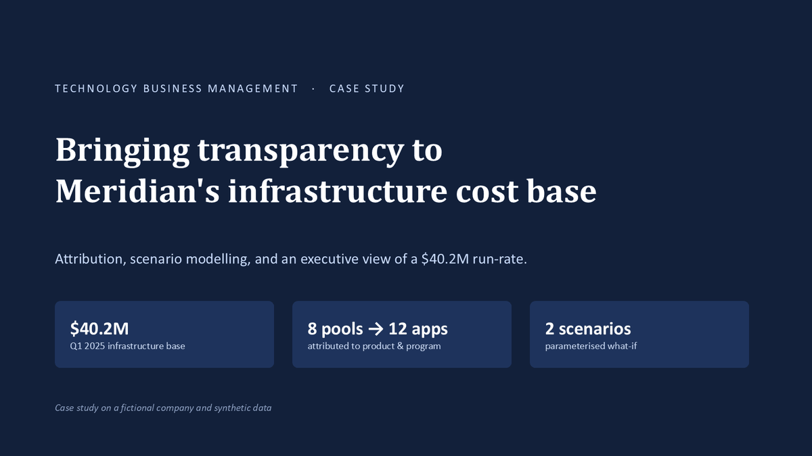
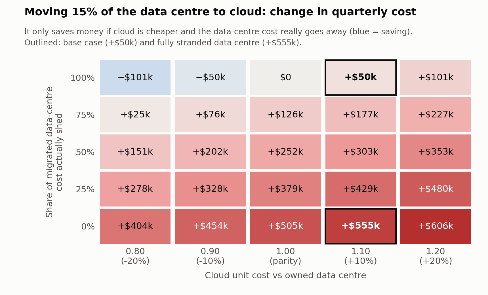

# Technology Infrastructure Cost Transparency

A three-day case study in Technology Business Management (TBM). The company, "Meridian Group", is fictional, and all data is synthetic.

Meridian's infrastructure costs sit in the General Ledger by cost pool (labour, hardware depreciation, licences, data centre, public cloud, managed services, network). Business owners see one fully-loaded number and can't tell what drives it or who consumes it. The work here attributes that $40.2M quarter down to products, applications, programs and funding requests, runs two what-if scenarios, and packages the result for a CFO.

**Stack:** Snowflake SQL, Power BI (PBIP / TMDL, DAX), dimensional modelling, DuckDB + Python for the local run.



[Full deck (PDF)](presentation/Meridian_Case_Study_Presentation.pdf) · [Dashboard wireframes](https://aaron-analogical.github.io/tech-cost-transparency/03_powerbi/C_Dashboard_Wireframes.html) · [Executive summary](04_executive_summary/D_Executive_Summary.md)

## Results (Q1 2025, $40.2M base)

- **The allocation reconciles to the GL to the cent**, for every month and every cost pool. Costs flow GL cost pool → product → application, then roll up to program and funding request.
- **Cost is concentrated.** Compute is about 50% of fully-loaded cost. Labour, Public Cloud and hardware depreciation drive about 70% of the base.
- **Budget variance nets to about 1%, but hides big offsets.** Compute runs 10% under budget in January and 21% under by March.
- **Vendor +8% scenario: +$204k.** It's certain and lands on Database and Cloud Platform.
- **Cloud migration (15% of the data centre) is a bet, not a saving.** The base case adds $50k, but across a ±20% cloud price range the result runs from −$101k to +$606k. The outcome depends on the cloud unit rate and, even more, on how much of the fixed data-centre cost really goes away once the workload leaves.



## Run it locally (no Snowflake needed)

```bash
pip install duckdb matplotlib
python run_local.py                        # loads data/, runs both SQL scripts, checks the results
python 02_scenarios/plot_sensitivity.py    # redraws the heatmap
```

`run_local.py` runs the same SQL that targets Snowflake, on DuckDB. It then checks that:

- the fully-loaded total, each month, and each month × cost pool reconcile to the GL
- the shared overhead pool is fully spread and no allocation is negative
- the vendor scenario equals 8% of the vendor pool
- the cloud scenario matches its closed form, `DC cost × 15% × (cloud factor − share of DC cost shed)`

It also writes the full sensitivity grid to [`S1_sensitivity_grid.csv`](02_scenarios/S1_sensitivity_grid.csv).

## What's in the repo

| Folder | Contents |
|---|---|
| [`01_attribution/`](01_attribution) | ER diagram ([SVG](01_attribution/A_Data_Model.svg)), data model notes, allocation + variance SQL, methodology note |
| [`02_scenarios/`](02_scenarios) | Parameterised scenario SQL, assumptions, results, sensitivity grid and heatmap |
| [`03_powerbi/`](03_powerbi) | Semantic model diagram, DAX measures, what-if parameter design, dashboard wireframes |
| [`04_executive_summary/`](04_executive_summary) | One-page summary for a non-technical CFO |
| [`presentation/`](presentation) | 19-slide deck (PPTX and PDF) |
| [`powerbi/`](powerbi) | Working Power BI project (PBIP) built on the Snowflake tables |
| [`data/`](data) | Synthetic source tables: 8 dimensions, 4 facts |

## Methodology choices

1. **Driver-based allocation.** `fact_allocation_map` says which consumption driver (vCPU-hours, GB stored, tickets, headcount) splits each pool; `fact_consumption` supplies the weights.
2. **Mixed-driver pools** (Labour, Data Centre) give equal weight to each driver group. This choice is behind the large End-User and Security figures, so the summary calls it out.
3. **Missing monthly driver feeds** carry forward the last known volume, so no cost leaks out of the allocation.
4. **Shared overhead** (CP99, about 8%) has no driver. It is spread pro-rata on direct-plus-allocated cost but kept in its own column, so it can be switched off.
5. **Variance** compares actuals to budget before overhead loading, matching how the budgets were set.
6. **Scenarios** are driven by one parameter table (`SCENARIO_PARAM`): migration share, cloud cost factor, share of data-centre cost shed, and the vendor rate rise.

The full reasoning is in [`A_Methodology_Note.md`](01_attribution/A_Methodology_Note.md) and [`B_Scenario_Results.md`](02_scenarios/B_Scenario_Results.md).

## Running on Snowflake and Power BI

**Snowflake.** Load the CSVs in `data/` into a schema (the scripts use `CASE_STUDY.MERIDIAN`), then run `01_attribution/A_Attribution_Variance.sql` followed by `02_scenarios/B_Scenario_Model.sql`.

**Power BI.** Open `powerbi/TechCostTransparency.pbip` in Power BI Desktop. In each table's source, replace `<your-account>` with your Snowflake account identifier, then refresh.
